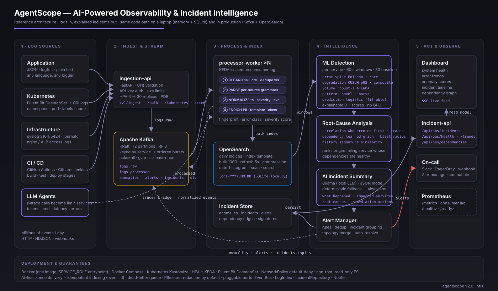
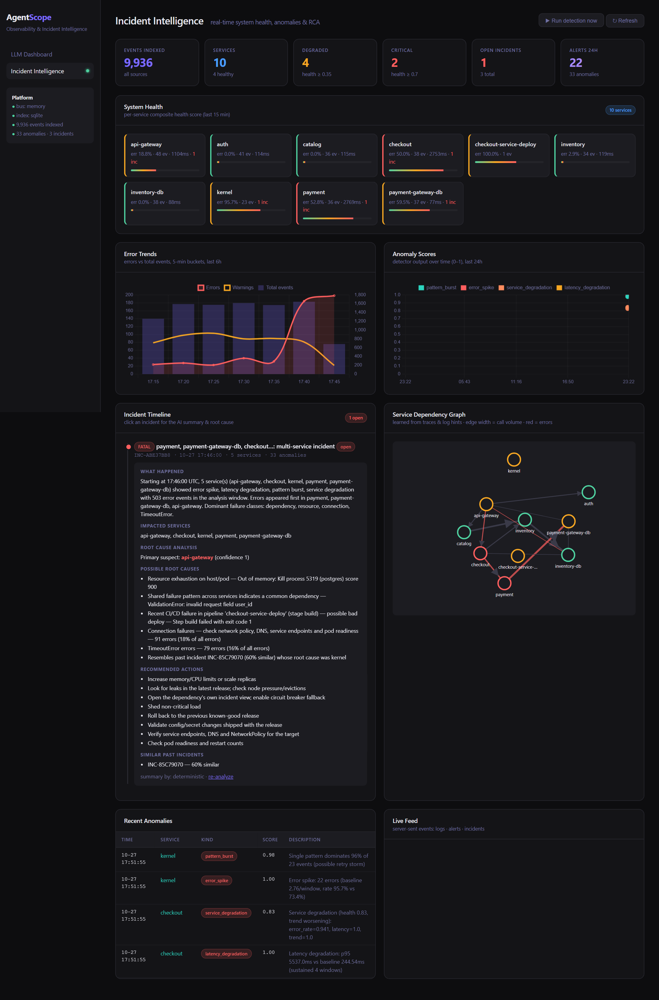
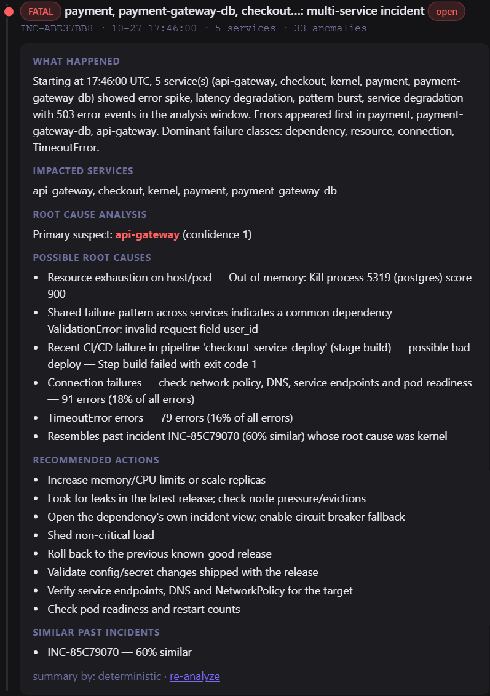
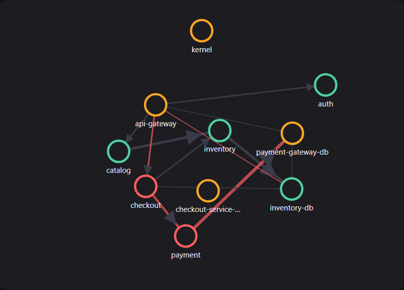
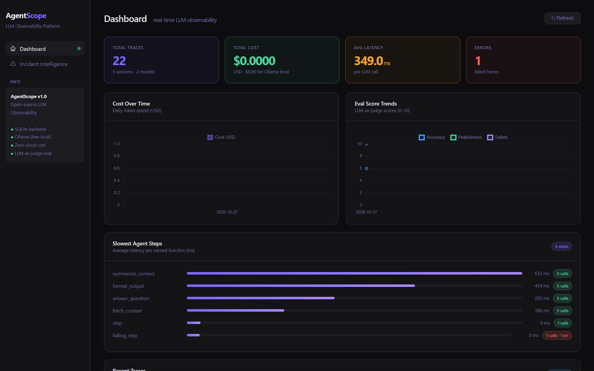

<div align="center">

# AgentScope

### AI-Powered Observability & Incident Intelligence Platform

**From raw logs to explained incidents — in one open-source stack.**

[](https://github.com/haarikaalla/llm-trace-pilot/actions)
[](https://python.org)
[](https://kafka.apache.org)
[](https://opensearch.org)
[](deploy/k8s)
[](docs/TESTING.md)
[](LICENSE)

[Architecture](#architecture) · [How it works](#how-it-works) · [Quickstart](#quickstart) · [Deployment](#deployment) · [Docs](#documentation)

</div>

---

## The problem

At 02:14 a payments database runs out of memory. Within ninety seconds the
payment service times out, checkout returns 503s, the API gateway starts
failing, and a deploy pipeline goes red. Four teams get four different pages.
The on-call engineer opens six dashboards, greps three log stores, and spends
forty minutes establishing what a single sentence could have said:

> *"payment-gateway-db is OOM-killing postgres; payment, checkout and api-gateway are downstream casualties. Raise the memory limit or roll back."*

Modern platforms emit **millions of log lines a day** across applications,
Kubernetes, infrastructure and CI/CD — and most incident time is still spent
by humans correlating them by hand.

## The solution

AgentScope is an end-to-end, self-hostable platform that **ingests every log,
detects what is abnormal, works out why, and tells you in plain language** —
then alerts the right people with a recommended fix.

| | Capability | What it means operationally |
|---|---|---|
| 📥 | **Unified ingestion** — application, Kubernetes, infrastructure, CI/CD and LLM-agent traces | One pipeline, one schema, one place to look |
| ⚡ | **Kafka-backed streaming**, OpenSearch indexing, at-least-once delivery, dead-letter queue | Millions of events/day without losing a record |
| 🧹 | **Clean → parse → normalize → enrich** with PII/secret redaction, log templating, error classification | Searchable, comparable, compliant data |
| 🧠 | **ML detection**: error spikes, latency & service degradation, volume anomalies, novel patterns, incident *prediction* | Catch it before customers do |
| 🔍 | **Root-cause analysis**: log correlation, learned service-dependency graph, historical incident matching | Points at the origin, not the symptoms |
| ✍️ | **AI incident summaries** (local LLM, deterministic fallback) | What happened · impacted services · root causes · remediation |
| 🚨 | **Real-time alerting** with dedup, incident grouping, topology-aware merging, auto-resolve | Four pages become one actionable incident |
| 📊 | **Engineering dashboards**: health, error trends, anomaly scores, incident timeline, dependency graph, live feed | Shared situational awareness |
| 🚢 | **Docker · Compose · Kubernetes** (Kustomize, HPA/KEDA, Fluent Bit, NetworkPolicies) | Production-ready from day one |

Runs with **zero infrastructure on a laptop** (in-memory bus + SQLite + Ollama)
and with **Kafka + OpenSearch in production** — same code, two environment variables.

---

## Architecture

<p align="center">
  
</p>

Clean architecture, five microservices, one container image:

| Service | Responsibility | Scales by |
|---|---|---|
| `ingestion-api` | Validates and keys records onto Kafka in O(1); API-key auth; size limits; DLQ | HPA on CPU (3 → 30 replicas) |
| `processor` | Consumes `logs.raw`, runs the 4-stage pipeline, bulk-indexes OpenSearch, republishes `logs.processed` | KEDA on consumer lag (≤ partitions) |
| `detector` | Windows the index, runs all detectors, groups incidents, performs RCA, writes AI summaries, notifies | Shard by service |
| `incident-api` | Read model: incidents, anomalies, health, trends, dependency graph, SSE live stream | Stateless |
| `dashboard` | Engineering UI; mounts the incident API; also hosts the original LLM-trace views | Stateless |

Every external system sits behind a **port** (`EventBus`, `LogIndex`,
`IncidentRepository`, `Notifier`), so Kafka, OpenSearch, SQLite and webhooks
are interchangeable adapters. Full design: [docs/ARCHITECTURE.md](docs/ARCHITECTURE.md).

---

## How it works

<p align="center">
  
</p>

The screenshot above is the platform running the bundled scenario
(`examples/simulate_logs.py`): 8 services, 4 log sources, ~10k events, and an
injected database OOM. Reading top to bottom:

**1. System health** — every service gets a composite health score
(error rate, latency inflation, pattern churn, trend). `checkout` and `payment`
are critical; `payment-gateway-db`, `api-gateway` and the `kernel` host logs
are degraded; everything else is healthy.

**2. Error trends & anomaly scores** — error volume over 5-minute buckets, and
every detector verdict plotted as a 0–1 score so you can see *which* signal
fired and *when*.

**3. Incident timeline with AI summary and RCA** — eleven anomalies across five
services were grouped into **one incident**. The root-cause engine ranked
`payment-gateway-db` as the origin (confidence 1.0) because it errored first,
sits deepest in failing request traces, and its own dependencies are healthy —
while its callers are failing. The summary states what happened, which
services were impacted, the probable causes (resource exhaustion), and
concrete remediation steps.

<p align="center">
  
</p>

**4. Service dependency graph** — learned automatically from trace hops, log
hints ("calling X", "upstream X") and structured attributes. Edge width is call
volume; red edges carry errors. The fault path
`api-gateway → checkout → payment → payment-gateway-db` is visible at a glance.

<p align="center">
  
</p>

**5. Live feed** — Server-Sent Events stream logs, alerts and incidents into
the UI the moment they happen.

### The pipeline in one picture

```
 raw record ──▶ CLEAN ──▶ PARSE ──▶ NORMALIZE ──▶ ENRICH ──▶ LogEvent ──▶ index
                ansi      per-source  ISO-8601 UTC   PII redaction
                ctrl      grammars    Severity enum  template + fingerprint
                length    k8s meta    5xx → ERROR    error class (timeout/db/oom/…)
                                      service slug   severity score
```

### Detection → incident → explanation

```
 windows(60s × 30) ─▶ detectors ─▶ anomalies ─▶ rules + dedup ─▶ alerts (Slack/PagerDuty/webhook)
                                        │
                                        └─▶ group by service + topology ─▶ INCIDENT
                                                 ├─ correlation  (who errored first, trace paths, shared patterns)
                                                 ├─ dependency   (origin ranking, blast radius)
                                                 ├─ history      (similar past incidents + what fixed them)
                                                 └─ AI summary   (what · impacted · why · fix)
```

---

## Quickstart

```bash
git clone https://github.com/haarikaalla/llm-trace-pilot.git
cd llm-trace-pilot
python -m venv venv && source venv/bin/activate      # Windows: venv\Scripts\activate
pip install -r requirements.txt

python examples/simulate_logs.py                     # multi-source logs + injected outage → detection → RCA → summary
uvicorn dashboard.app:app --reload --port 8080
```

Open **http://localhost:8080/observability**. No Kafka, OpenSearch, GPU or
cloud account required. Install [Ollama](https://ollama.ai) (`ollama pull llama3.2`)
to switch incident summaries from deterministic to LLM-generated.

### Send your own logs

```bash
uvicorn observability.services.ingestion_api:app --port 8081

# structured, plain text, syslog, CI output — source is auto-detected
curl -X POST localhost:8081/v1/ingest -H 'content-type: application/json' -d '{
  "records": [
    {"message": "{\"level\":\"error\",\"msg\":\"TimeoutError calling payments-db\",\"service\":\"checkout\",\"duration_ms\":5000}"},
    {"message": "<34>Oct 27 10:00:03 node-2 kernel: Out of memory: Kill process 1234 (postgres)"},
    {"message": "##[error]Process completed with exit code 1.", "pipeline": "deploy-checkout"}
  ]}'

# whole files
curl -X POST 'localhost:8081/v1/ingest/bulk?source_type=infrastructure' --data-binary @/var/log/syslog
```

Kubernetes clusters ship automatically via the bundled
[Fluent Bit DaemonSet](deploy/k8s/fluent-bit.yaml); CI systems via
[ship-ci-logs.yml](.github/workflows/ship-ci-logs.yml).

### Python API

```python
from observability.services.platform import get_platform

p = get_platform()                 # memory + SQLite unless EVENT_BUS / LOG_INDEX say otherwise
p.ingest(records)                  # clean → parse → normalize → enrich → index
result = p.run_detection()         # anomalies, alerts, incidents with RCA + summary

inc = p.repo.get_incident(result["incidents"][0]["incident_id"])
inc.root_cause["primary"]          # 'payment-gateway-db'
inc.summary["what_happened"]       # narrative
inc.summary["recommended_actions"] # ['Increase memory/CPU limits or scale replicas', ...]
```

### LLM observability (built in)

AgentScope began as an LLM tracing tool and still is one. The `@trace`
decorator, `AgentSession` grouping, LLM-as-judge evaluation and prompt
versioning are all here — and every traced call also flows into the
observability pipeline as an `llm.<step>` service, so an error burst from
`gpt-4o` timeouts gets the same detection, incident and RCA treatment as a
backend service.

```python
from tracer import trace, AgentSession
from evaluator import evaluate

@trace(name="answer_question", model="llama3.2", tags=["prod"])
def answer(prompt: str) -> str: ...

with AgentSession("research_agent"):
    out = answer(prompt="Explain CUSUM")
scores = evaluate(prompt="Explain CUSUM", response=out)   # accuracy / helpfulness / safety
```

<p align="center">
  
</p>

---

## Deployment

| Mode | Command | Backends |
|---|---|---|
| **Local** | `uvicorn dashboard.app:app --port 8080` | in-memory bus · SQLite · Ollama |
| **Docker Compose** | `cd deploy/docker && docker compose up --build -d` | Kafka (KRaft) · OpenSearch · 5 services |
| **Kubernetes** | `kubectl apply -k deploy/k8s` | Kustomize · HPA + KEDA · Fluent Bit · Ingress · NetworkPolicies |

One image serves every role via `SERVICE_ROLE`. Security defaults: non-root,
read-only root filesystem, dropped capabilities, restricted Pod Security,
default-deny network policy, API-key ingestion, PII redaction on.

Full guide with hardening checklist and configuration reference:
[docs/DEPLOYMENT.md](docs/DEPLOYMENT.md).

---

## Engineering

```
observability/            clean-architecture platform
├── domain/               entities + ports (no I/O)
├── streaming/            InMemoryBus · KafkaBus
├── ingestion/            4 source parsers · collector
├── pipeline/             clean → parse → normalize → enrich
├── storage/              SQLiteLogIndex · OpenSearchLogIndex · incident repository
├── ml/                   spike · degradation · volume · patterns · prediction · engine
├── rca/                  correlation · dependency graph · historical matching
├── intelligence/         AI incident summaries
├── alerting/             rules · dedup · notifiers · incident lifecycle
├── integrations/         @trace → log events bridge
└── services/             platform facade · ingestion-api · processor · detector · incident-api
tracer/ evaluator/ prompts/ dashboard/      original LLM-observability modules (extended)
deploy/docker  deploy/k8s                   Compose stack · Kustomize manifests
tests/                                      76 tests, no infrastructure required
```

| Quality gate | Status |
|---|---|
| Unit · component · end-to-end · HTTP contract tests | `pytest tests/ -v` — 76 passing in ~3 s |
| CI | tests on 3.10/3.11/3.12 · e2e simulation · Docker build · Kustomize validation |
| Throughput (single process, SQLite) | 1–5k events/s; Kafka + OpenSearch path designed for 10M+/day |
| Delivery guarantees | at-least-once + idempotent indexing; DLQ for malformed/oversized |

Testing strategy: [docs/TESTING.md](docs/TESTING.md).

## Documentation

| Document | Contents |
|---|---|
| [docs/ARCHITECTURE.md](docs/ARCHITECTURE.md) | layers, data flow, ML & RCA design, decisions |
| [docs/DEPLOYMENT.md](docs/DEPLOYMENT.md) | local / Compose / Kubernetes, hardening, config reference, operations |
| [docs/TESTING.md](docs/TESTING.md) | test pyramid, isolation, load testing, detector quality |
| [docs/IMPLEMENTATION_SUMMARY.md](docs/IMPLEMENTATION_SUMMARY.md) | everything added or changed, verified results, roadmap |
| [SETUP.md](SETUP.md) | step-by-step first-run guide |

## Tech stack

FastAPI · Uvicorn · Apache Kafka · OpenSearch · SQLite (WAL) · Ollama ·
Jinja2 · Chart.js · Server-Sent Events · Fluent Bit · Docker · Kubernetes ·
Kustomize · KEDA · GitHub Actions. ML and RCA are pure Python — no native
dependencies, explainable scores, deterministic tests.

## License

MIT © 2025
