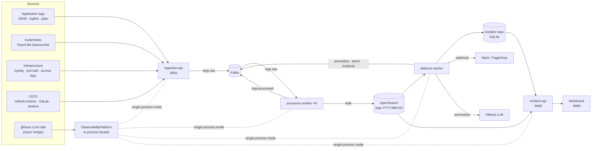

# Architecture

AgentScope v2 extends the original LLM-observability tool into an enterprise
observability and incident-intelligence platform. The design follows clean
architecture: the **domain** (entities + ports) has no I/O; **adapters**
(Kafka, OpenSearch, SQLite, webhooks) plug in behind ports; **application
services** (ML, RCA, alerting, summaries) depend only on ports; **entrypoints**
(FastAPI apps, workers) are thin.

## 1. System context



## 2. Package layout

```
observability/
├── config.py            Settings (env-driven, frozen dataclass)
├── domain/
│   ├── models.py        LogEvent · Anomaly · Incident · Alert · ServiceHealth · DependencyEdge
│   └── ports.py         EventBus · LogIndex · IncidentRepository · Notifier (ABCs)
├── streaming/           InMemoryBus · KafkaBus · Topics
├── ingestion/           parsers (4 source types + auto-detect) · Collector
├── pipeline/            CleaningStage → ParsingStage → NormalizationStage → EnrichmentStage · LogProcessor
├── storage/             SQLiteLogIndex · OpenSearchLogIndex · SQLiteIncidentRepository · factory
├── ml/                  features · anomaly · spike · degradation · patterns · prediction · DetectionEngine
├── rca/                 LogCorrelator · ServiceGraph/DependencyMapper · HistoricalMatcher · RootCauseAnalyzer
├── intelligence/        IncidentSummarizer (Ollama JSON → deterministic fallback)
├── alerting/            AlertRule · AlertManager (dedup, grouping, merge, auto-resolve) · notifiers
├── integrations/        tracer_bridge — @trace calls become llm.* services
└── services/            platform.py (composition root) · ingestion_api · processor_worker · detector_worker · incident_api
```

Existing packages (`tracer/`, `evaluator/`, `prompts/`, `dashboard/`) are kept
and extended, not replaced.

## 3. Data flow

### 3.1 Ingestion (high throughput)

* `Collector.ingest()` does O(1) validation per record (type + size) and
  publishes to `logs.raw` keyed by `service` so one service's burst lands on a
  single partition and preserves ordering. Parsing is deferred to the processor.
* Kafka producer: `acks=all`, gzip, `linger_ms=20`, 64 KB batches; consumer:
  manual commit after the batch is handed over (**at-least-once**). Index writes
  are idempotent on `event_id`, so redelivery never duplicates documents.
* Oversized or malformed records go to `logs.dlq` — never silently dropped.
* Sizing: a single processor replica sustains ~1–3k events/s on a laptop with
  SQLite; with 12 partitions, 12 replicas and OpenSearch bulk (chunk 1000,
  `refresh_interval=5s`) the design target of 10M+ events/day (≈120/s average,
  ~5k/s peaks) is met with large headroom. KEDA scales processors on consumer lag.

### 3.2 Pipeline

| Stage | Responsibility |
|---|---|
| **Cleaning** | strip ANSI/control chars, collapse whitespace, cap length, drop empties |
| **Parsing** | detect source → parser → canonical fields (level, ts, service, k8s metadata, status, latency, trace id, exception) |
| **Normalization** | ISO-8601 UTC timestamps, `Severity` enum (30+ aliases), 5xx→ERROR, service slug |
| **Enrichment** | PII/secret redaction (emails, cards, tokens, JWTs, AWS keys), template extraction (`<num> <ip> <uuid> <url> …`), stable fingerprint, error classification (timeout/connection/database/auth/resource/kubernetes/build/test/deploy/…), severity score |

### 3.3 Storage

* **OpenSearch**: daily indices behind an index template (keyword fields,
  `flat_object` attributes, `best_compression`), `date_histogram` aggregations
  for trends, `scan` for detector windows.
* **SQLite** (dev/edge/tests): WAL mode, `executemany` bulk insert, composite
  indexes on `(service, ts)`, `trace_id`, `fingerprint`.
* Incident repository (anomalies, incidents, alerts, dependency edges) is
  SQLite on a shared PVC — small, relational, strongly consistent.

## 4. Machine learning

All detectors are unsupervised, pure Python, and run per `(service, 60s window)`
against the last 30 windows.

| Capability | Detector | Technique |
|---|---|---|
| Error spike | `ErrorSpikeDetector` | Poisson tail probability of error count + error-rate ratio vs baseline |
| Anomaly (volume) | `VolumeAnomalyDetector` | ensemble of robust z-score (median/MAD) and EWMA; flags floods *and* silence |
| Latency / service degradation | `LatencyDegradationDetector`, `ServiceDegradationDetector` | one-sided CUSUM on p95 (sustained ≥2 windows); weighted composite of error-rate, latency inflation, pattern churn, trend slope |
| Unusual patterns | `PatternDetector` | novel error fingerprints vs baseline; single-template bursts (retry storms) |
| Incident prediction | `IncidentPredictor` | logistic model on leading indicators (error velocity, warning velocity, latency drift, novelty, fatal flag); `fit()` for supervised refit |

Partial windows are scaled by elapsed fraction and never produce "volume down"
alerts. Scores are in `[0,1]`; `ANOMALY_THRESHOLD` (default 0.7) gates alerts.

## 5. Root-cause analysis

1. **Log correlation** — first-error timeline (who errored first), trace-path
   reconstruction (deepest failing hop), shared templates across services,
   error-type mix, hot hosts/pods, k8s/resource/CI signals.
2. **Dependency mapping** — graph from declared edges, `target_service`
   attributes, trace hop ordering (direction-consistency filtered) and message
   hints ("calling X", "upstream X"). Ranking: a failing service whose
   downstream dependencies are healthy is the likeliest origin; blast radius =
   transitive callers.
3. **Historical comparison** — incident *signature* (services, error types,
   fingerprints, kinds, features); weighted Jaccard + cosine similarity to past
   incidents returns "seen before" with the previous root cause and remediation.

## 6. Incident lifecycle & alerting

```
anomalies ─▶ AlertRule match ─▶ dedup (per rule·service·kind, 5 min) ─▶ notify (console/webhook)
          └▶ attach to open incident for the service (10 min window) or a topology neighbour
             ─▶ merge incidents that are graph-neighbours ─▶ RCA + AI summary ─▶ subsume covered incidents
             ─▶ auto-resolve when all services quiet past the grace period
```

Predictions raise early-warning alerts but never open incidents.

## 7. AI summaries

`IncidentSummarizer` prompts a local Ollama model with the *structured* RCA
evidence (never raw logs) and asks for strict JSON (`format: json`). Any
failure falls back to a deterministic summary built from the same evidence,
so the four sections — what happened, impacted services, possible root causes,
recommended remediation — are always present. `generated_by` records the path.

## 8. Dashboards & real time

`/observability` renders: system health cards, error trends (5-min buckets),
anomaly-score scatter, incident timeline with expandable AI summary/RCA,
layered SVG dependency graph (edge width = calls, red = error share), recent
anomalies, and a live SSE feed (`/api/obs/stream`) of logs, alerts, incidents.

## 9. Deployment topology

| Service | Role | Scaling |
|---|---|---|
| `ingestion-api` | HTTP collector → Kafka | HPA on CPU, 3–30 replicas, PDB |
| `processor` | Kafka → pipeline → OpenSearch | KEDA on consumer lag, ≤ partitions |
| `detector` | windows → ML → alerts → RCA → summaries | 1 (shard by service for more) |
| `incident-api` | read model + RCA on demand | 1 (shares state PVC) |
| `dashboard` | UI + mounts incident API | 1 |
| `fluent-bit` | DaemonSet shipping k8s logs | one per node |

Security: non-root, read-only root FS, dropped capabilities, restricted PSS
namespace, default-deny NetworkPolicy, API-key on ingestion, PII redaction on
by default, webhook URLs validated as http(s).

## 10. Design decisions

* **Pluggable backends via ports** — the same code runs with zero infra
  (memory + SQLite) and in production (Kafka + OpenSearch). Tests run the real
  pipeline end-to-end in-process.
* **Parse late, validate early** — ingestion stays O(1) per record; the CPU
  heavy work scales independently in processor replicas.
* **Pure-Python statistics instead of a heavy ML stack** — zero native deps,
  explainable scores, deterministic tests; `IncidentPredictor.fit()` is the hook
  for learned weights.
* **One image, many roles** — `SERVICE_ROLE` selects the entrypoint; every
  microservice ships the same tested artifact.
